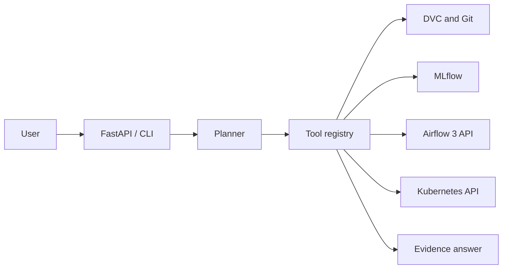

# Architecture

The user talks to one agent. The agent selects tools, executes them, and writes an answer from the returned records. It separates facts, uncertainties, and recommended actions. Retraining and other state changes are never a side effect of a question about whether they are necessary.

## Request path

1. `agent.planner.plan_message` maps the text onto an ordered tool list. If `LLM_PLANNER=true` and an API key is set, the orchestrator may accept a JSON tool list from that API, then falls back to the deterministic plan on any error.
2. `agent.tools.base.Registry.execute` runs one tool with a timeout and writes a JSON log line: `request_id`, `tool`, `status`, `duration_ms`, and a scrubbed error.
3. Provenance for “which dataset trained this model” is copied from the MLflow run params `dataset_version`, `git_commit`, and `dataset_md5` into `get_dataset_version`. The DVC tool reports whether those values match the workspace. It does not substitute the workspace identity when MLflow returned nothing.
4. The composer emits a fact only when the corresponding tool result is `ok`. An unavailable tool becomes an uncertainty. The answer states that no operational claim is made when every relevant tool failed.

## Training and deployment path

DVC stages in `dvc.yaml` and the Airflow DAG `ml_training_pipeline` call the same commands:

`validate -> preprocess -> train -> evaluate -> quality_gate -> promote`

`training/train.py` validates the churn table, fits a logistic regression, logs metrics and dataset provenance to MLflow, and writes `metrics/evaluation.json`. `quality_gate` exits with an error when F1 is below the threshold. `promote` checks that flag again before writing `models/PROMOTED.json`. Airflow marks downstream tasks upstream-failed when validation or the gate raises. `train` uses two retries. The gate uses zero retries so a real miss is not hidden.

The inference container is `api/main.py`. Kubernetes runs two replicas behind a ClusterIP Service. The ConfigMap supplies the non-secret settings. Readiness calls `/ready`, which fails while the model file is absent. Liveness calls `/health`.

## Tool catalog and permissions

| Tool | System | Effect | Permission |
| --- | --- | --- | --- |
| `list_datasets` | DVC | Read tracked paths | Always allowed |
| `get_dataset_version` | DVC, Git | Read label, MD5, commit, recorded provenance | Always allowed |
| `compare_dataset_versions` | Git | Read blobs for two revisions | Revision must match a restricted character set |
| `detect_dataset_changes` | DVC, Git | Read status | Always allowed |
| `explain_reproduction` | DVC | Describe checkout commands | Does not execute them |
| `checkout_dataset` | DVC, Git | Check out an approved path | `confirm=true` required |
| `list_experiments` | MLflow | Read experiments | Always allowed |
| `list_runs` | MLflow | Read recent runs | Always allowed |
| `get_run` | MLflow | Read params, metrics, artifacts | Always allowed |
| `find_best_run` | MLflow | Rank a metric and a quality-gate candidate | Does not register or promote |
| `compare_runs` | MLflow | Read several runs | Does not promote |
| `list_registered_models` | MLflow | Read the registry | Always allowed |
| `list_dags` | Airflow | Read DAG metadata | Always allowed |
| `get_dag_runs` | Airflow | Read run state | Always allowed |
| `get_failed_tasks` | Airflow | Read failed task instances | Always allowed |
| `get_task_diagnostics` | Airflow | Read task log excerpts | Always allowed |
| `trigger_training_dag` | Airflow | Create a DAG run | `confirm=true` and DAG id in `AIRFLOW_APPROVED_DAGS` |
| `list_workloads` | Kubernetes | Read Pods and Deployments | Read |
| `get_pod_logs` | Kubernetes | Read logs | Read |
| `list_services` | Kubernetes | Read Services | Read |
| `get_deployed_version` | Kubernetes | Read deployment labels and images | Read |
| `diagnose_application` | Kubernetes | Read status, events, and unhealthy logs | Read |
| `restart_deployment` | Kubernetes | Patch a rollout annotation | `confirm=true` and namespace equal to `APPROVED_K8S_NAMESPACE` |

Shell arguments for DVC and Git are fixed lists inside `agent/tools/dvc_tools.py`. User text is not interpolated into a command. Airflow passwords and API keys are redacted from logs.

## Multi-tool scenario

The question that asks for the best recent model, its dataset version, deployment status, and whether retraining is necessary always calls, in order:

1. `find_best_run`
2. `get_dataset_version` with the params stored on that run
3. `diagnose_application`
4. `get_dag_runs`

It does not call `trigger_training_dag`. A retraining recommendation is added only when the tool payload shows a failed quality gate or a failed DAG run. The recommendation text says the run was not started.
